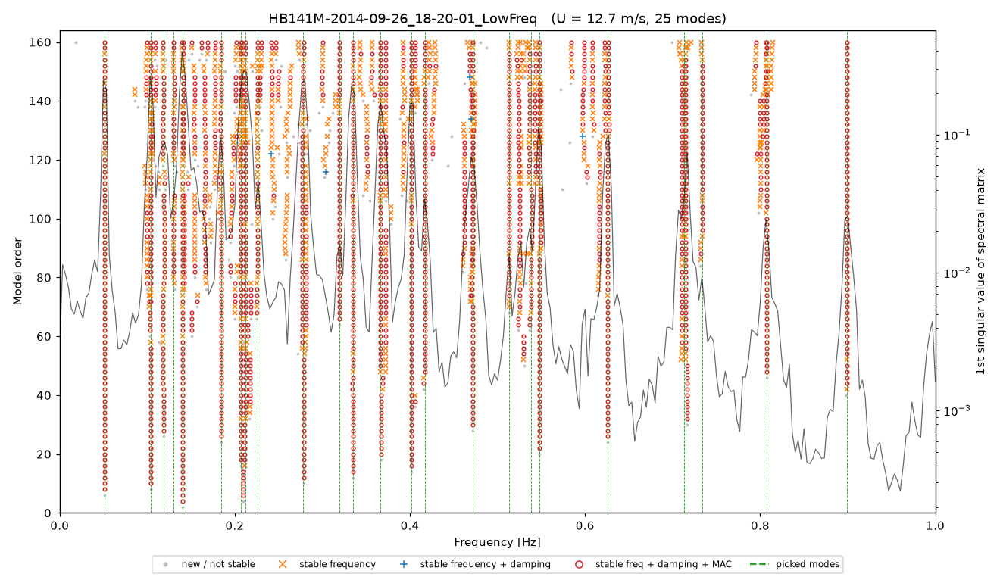
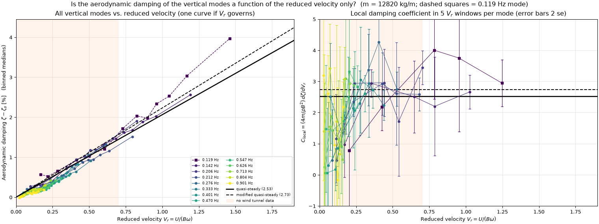
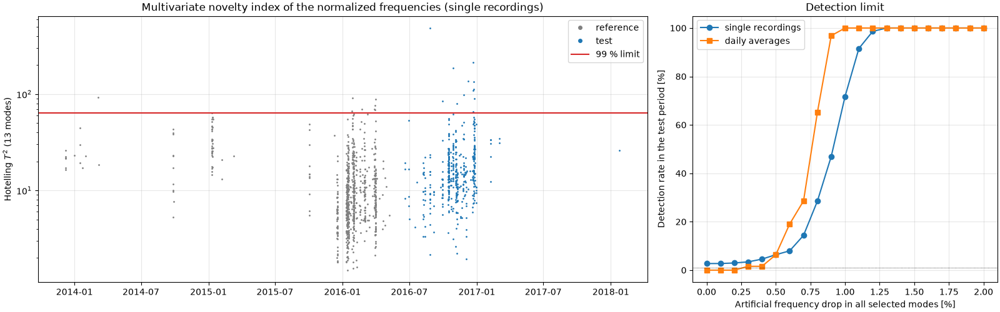
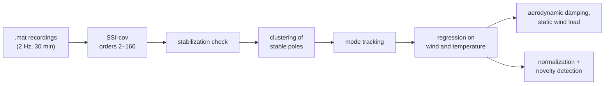

# Hardanger Bridge – operational modal analysis

[](https://github.com/hennindg/hardanger-oma/actions/workflows/tests.yml)


Operational modal analysis (OMA) of the Hardanger Bridge (1310 m main span) in Python, using numpy
and scipy. The code identifies about 25 modes per recording with covariance-driven stochastic subspace
identification (SSI-cov) and automatic mode picking, tracks them through 1,485 thirty-minute
recordings from 2013–2018, and fits the effect of wind and temperature on frequencies and damping.
The normalized frequencies are then used to estimate how large a stiffness loss could be detected.



## Main results

| | |
|---|---|
| Identification | About 25 modes per recording between 0.05 and 0.95 Hz, no manual input. Frequencies within −1.2 to +0.3 % of Petersen & Øiseth (2017) |
| Temperature | −0.02 to −0.07 % frequency per °C, more for the higher vertical modes |
| Wind | Vertical frequencies increase with U² (static wind load on the cables); lateral and torsional frequencies decrease |
| Aerodynamic damping | Against reduced velocity, the damping of the 13 vertical modes falls close to quasi-steady theory with the wind-tunnel coefficients. Fitted heave coefficient C_heave = 2.11 [2.02, 2.18] without bias correction (wind tunnel 2.53); about 3.0 [2.70, 3.25] after correcting the SSI damping bias (correction only partly validated, see the report) |
| Damage detection | After normalization, a Hotelling T² chart detects a 1.1 % drop in all frequencies in 90 % of single recordings (2.7 % false alarms). That is about 3.5 % loss of cable stiffness. Local girder damage is only detectable if 40–160 m of girder lose their bending stiffness |
| Damping bias | SSI-cov underestimates damping above about 2 % on 30-minute records (up to −1 %-point at 3.4 %). Estimated for each recording with a simulated copy of it, and corrected |

Details and figures are in the [technical report](docs/report.md).

<p align="center">
  
  
</p>

## How it works



| Folder | Contents |
|---|---|
| [`oma/`](oma) | General OMA code, independent of the bridge: SSI-cov, automatic mode picking (clustering of stable poles), mode tracking, block bootstrap, simulation of test records |
| [`hardanger/`](hardanger) | Bridge-specific code: data reader, plots, regression models, novelty detection, literature values, simulated girder |
| [`pipeline/`](pipeline) | One script per analysis step (below) |
| [`studies/mode_0119/`](studies/mode_0119) | Separate study of the 0.119 Hz antisymmetric vertical mode |
| [`tests/`](tests) | Unit tests, including identification of simulated systems with known modal properties |
| [`literature/`](literature) | Literature values with their sources, each checked against the papers |
| [`docs/`](docs) | Technical report and figures |

### Pipeline steps

| Step | Script | What it does |
|---|---|---|
| 1 | `step1_spectra` | Acceleration spectra of one recording |
| 2 | `step2_ssi` | SSI-cov and stabilization diagram of one recording |
| 3 | `step3_autopick` | Automatic mode picking (clustering of stable poles) |
| 4 | `step4a_run_all`, `step4b_tracking` | Steps 2–3 on all recordings; mode tracking per data set |
| 5 | `step5_wind` … `step5j_freezing` | Tracking over all data; regressions on wind and temperature, damping scaling, turbulence, reduced velocity, low-wind amplitude, block bootstrap, wind direction, static wind load, freezing |
| 6 | `step6_normalization`, `step6b_damage_patterns`, `step6c_cable_girder_model` | Environmental normalization and Hotelling T²; detection limits of damage patterns; cable–girder model |
| 7 | `step7a` … `step7e` | Sensitivity to the SSI settings; damping bias: simulation, correction, results |

All settings a user may want to change are in a `SETTINGS` block at the top of each script.

## Quick start

```bash
git clone https://github.com/hennindg/hardanger-oma.git
cd hardanger-oma
python -m pip install -r requirements.txt
```

Download the data (27 zip files, about 4.3 GB, from the NTNU open data repository), or point the
scripts to an existing copy with the environment variable `HARDANGER_DATA` (see `hardanger/paths.py`):

```bash
python -m tools.download_data
```

Run the steps from the repository folder, for example:

```bash
python -m pipeline.step3_autopick
```

Run the tests:

```bash
python -m pip install -r requirements-dev.txt
python -m pytest
```

Steps 4a, 7a and 7d process hundreds of recordings and take hours. They skip recordings that are
already done, so they can be stopped and restarted.

## Data

*Wind and Acceleration Data from the Hardanger Bridge*, NTNU, DOI
[10.21400/5ng8980s](https://doi.org/10.21400/5ng8980s), licensed CC-BY 4.0; described in the data
paper by Fenerci, Kvåle, Petersen, Rønnquist and Øiseth. The data are not included in this repository.

## License

Code: [MIT](LICENSE). The data have their own license (CC-BY 4.0, see above).
