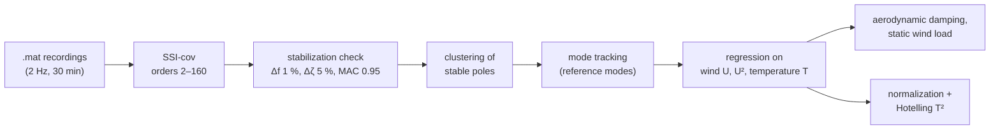
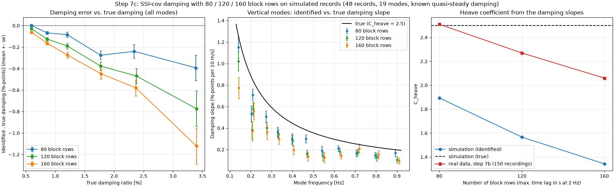
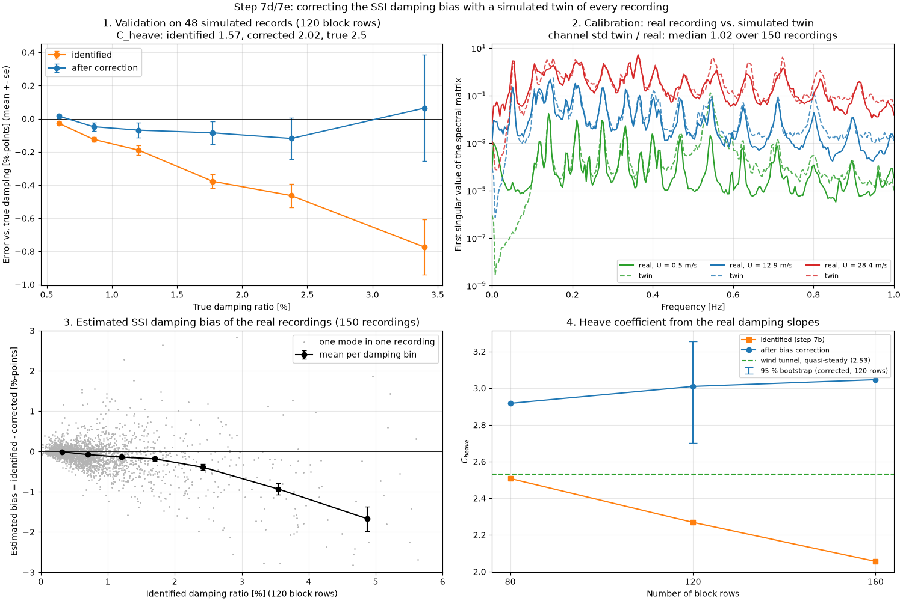
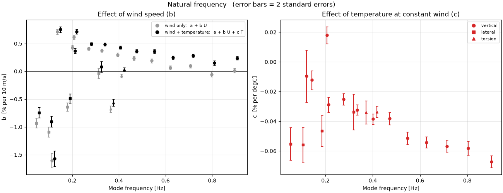

# Operational modal analysis of the Hardanger Bridge

Technical report. Covers automatic SSI-cov identification of 1,766 recordings, the effect of wind and
temperature on frequencies and damping, environmental normalization for damage detection, and a
simulation study of the bias in the identified damping.

---

## Contents
1. [The bridge and the data](#1-the-bridge-and-the-data)
2. [Method](#2-method)
3. [Validation of the method](#3-validation-of-the-method)
4. [Results: natural frequencies](#4-results-natural-frequencies)
5. [Results: damping and aerodynamic damping](#5-results-damping-and-aerodynamic-damping)
6. [Damage detection](#6-damage-detection)
7. [Limitations](#7-limitations)
8. [References](#8-references)

---

## 1. The bridge and the data

The Hardanger Bridge (Norway, opened 2013) is a suspension bridge with a 1310 m main span, an
18.3 m wide and 3.25 m deep steel box girder and 186 m high concrete towers. NTNU has monitored it
since 2013 with 20 triaxial accelerometers (girder sections H1–H9 on the east and west side, and the
tower tops) and 9 sonic anemometers (Fenerci et al., data paper; data set DOI
[10.21400/5ng8980s](https://doi.org/10.21400/5ng8980s), CC-BY 4.0).

This project uses the LowFreq version of the data, resampled to 2 Hz (Nyquist frequency 1 Hz). There
are 27 data sets with 1,766 recordings of 30 minutes: September 2014, five named storms, 100
maximum-wind events, eight low-wind events and the full year 2016. Some recordings are in two data
sets (an event and its month). After removing duplicates, 1,485 recordings are tracked, and 1,479 of
them have valid wind and temperature data for the regressions.

Two properties of the data matter for everything below:

- Recordings are wind-triggered. A recording starts when the 1-minute mean wind exceeds 15 m/s; the
  low-wind events were added separately. Mean wind speeds are 0–28 m/s, from two directions roughly
  perpendicular to the bridge (east about 75–120°, west about 250–320°).
- Wind and temperature are correlated, because the windy recordings are mostly from winter storms.
  Wind effects therefore have to be estimated at constant temperature, and the other way round.

Only the girder accelerometers are used: 16 sensors with lateral (y) and vertical (z) components, up
to 32 channels. Channels with poor-quality data are dropped per recording, and channels are matched by
name, not by position in the file.

## 2. Method

The pipeline is a set of scripts in `pipeline/`, one per step. They use a general OMA library in
`oma/` that works on plain arrays and does not depend on the Hardanger file format.

**Covariance-driven SSI** (`oma/ssi_cov.py`). The output covariances R_i = E[y(k+i) y(k)ᵀ] are
arranged in a block Toeplitz matrix with s = 120 block rows. This gives time lags up to 120 s, about
six periods of the lowest mode (0.052 Hz). One SVD gives the observability matrix for all model orders
n = 2…160. The system matrices A and C follow from its shift structure, and the poles give the
frequencies, damping ratios and complex mode shapes. Only the 160 largest singular values are needed,
so a truncated (Lanczos) SVD is used. It gives the same poles and is 3–7 times faster.

**Automatic mode picking** (`oma/mode_clustering.py`, following Magalhães, Cunha & Caetano 2009).
A pole is stable if its frequency, damping and mode shape change by less than 1 %, 5 % and
1 − MAC = 0.05 from the previous model order. Stable poles are clustered with single linkage on the
distance d = |Δf|/f + (1 − MAC), with a limit of 0.05. A cluster is accepted as a mode if it contains
poles from at least 20 of the 80 model orders. Damping outliers within a cluster are removed with the
box-plot rule. This gives about 25 modes per recording between 0.05 and 0.95 Hz, with no manual
choices.

**Mode tracking** (`oma/mode_tracking.py`). Reference modes are built from the 34 recordings of two
events (September 2014 and storm Urd) by pairwise average-linkage tracking. The modes of every other
recording are assigned to these references with the same distance measure (d ≤ 0.2, MAC on the
channels both recordings have, one mode per reference). The tracked frequencies are within −1.2 % to
+0.3 % of the 30 modes that Petersen & Øiseth (2017) identified from a 2-hour low-wind recording.

**Statistics.** For each mode, f = a + b·U + c·T and ζ = a + b·U + c·T (and versions with U²) are
fitted by least squares. Consecutive recordings are strongly correlated, since a storm lasts many
hours, so the uncertainties are computed with a block bootstrap that resamples whole days (158 days,
1,000 repetitions). The ordinary least-squares standard errors are 1.1–4.1 times too small (median
2.1).

## 3. Validation of the method

| Check | How | Result |
|---|---|---|
| Unit tests | `tests/`: known 3-mode system, covariances, MAC, stability, clustering, tracking, bootstrap | 17 tests, run on every push (GitHub Actions) |
| Reproducibility | robustness baseline vs. the original step 4 run | 2,698 of 2,698 modes identical |
| Settings | 11 variants of block rows, maximum order, stability tolerances, cluster distance and minimum orders, on 150 recordings spread over the wind speed range (steps 7a/7b) | ≥ 99.3 % of the modes found in every variant, median Δf ≤ 0.04 %, Δζ ≤ 0.05 %-points; temperature coefficients change by less than 1.3 bootstrap standard errors |
| Gusty wind | simulated non-stationary forcing with a turbulence-shaped spectrum (study of the 0.119 Hz mode) | bias below 0.7 % in frequency and 0.7 %-points in damping |
| Damping bias | simulation with known damping (step 7c), simulated copy of every recording (steps 7d/7e) | see 3.1 and 3.2 |

### 3.1 SSI-cov underestimates high damping on 30-minute records

Of all the settings, only the number of block rows changed the results noticeably. With 80 rows the
damping increased faster with wind than with 160 rows: C_heave was 2.51 / 2.27 / 2.06 for
80 / 120 / 160 rows. This spread is as large as the bootstrap confidence interval.

To find out which setting is right, I simulated a simplified girder with known damping: the real
sensor layout, 19 sinusoidal modes driven by white noise, 5 % sensor noise, and damping equal to 0.5 %
structural plus quasi-steady aerodynamic damping with C_heave = 2.5. SSI-cov underestimates the
damping, and the error grows with the damping and with the number of block rows. At 3.4 % true damping
the error is −0.4 / −0.8 / −1.1 %-points for 80 / 120 / 160 rows; at 1 % it is only −0.1 to −0.2.
The bias is already in the raw poles at every model order, so it does not come from the stability
check or the clustering, and it disappears for very long records. It is therefore a finite-record
effect: for a heavily damped mode the true covariance has decayed after a few periods, and the longer
lags contain mostly estimation noise. Since the windy recordings have the highest damping, they are
underestimated most, and the fitted increase of damping with wind is too small: C_heave comes out as
1.89 / 1.57 / 1.34 instead of 2.5.

### 3.2 Correcting the bias with a simulated copy of each recording

The size of the bias for a real recording depends on its modes, response levels and noise. So for
each recording I estimated these from the recording itself and simulated a copy with the same
properties (step 7d):

- the identified modes (frequency, damping, mode shape);
- the response level of each mode, from a band-pass and modal filter;
- the noise of each channel, taken as the part of the signal that the identified modes do not explain.

The copy is identified with the same settings, and the difference between identified and input
damping is the bias. Because the bias depends on the true damping, not the identified one, this is
repeated once with the corrected damping as input.

Results (step 7e, 120 block rows unless stated):

- **Validation on the 48 simulated records from 3.1.** After correction, the average damping error
  is within ±0.12 %-points at every damping level, compared with up to −0.78 %-points before. The
  random error per record increases, to about ±1.1 %-points for modes with 2–5 % damping. However,
  the C_heave fitted to the corrected simulated damping is 2.02, not the true 2.5 (1.57 before
  correction). So the correction removes the average error at each damping level, but the fitted
  slope is still too low. I have not found the reason yet.
- **Calibration.** The simulated copies have about the same signal level as the real recordings
  (median ratio 1.02, 5–95 % range 0.91–1.74), and their spectra match the real ones well at low,
  medium and high wind. The estimated noise is about 1 % of the channel standard deviation.
- **Bias on the real recordings.** The estimated bias increases with damping: −0.08 %-points at 0.7 %
  identified damping, −0.39 at 2.4 %, −0.93 at 3.5 % and −1.7 at 4.9 %.
- **C_heave on the real recordings.** Before correction 2.51 / 2.27 / 2.06 for 80 / 120 / 160 block
  rows; after correction 2.92 / 3.01 / 3.05. After correction the result no longer depends on the
  number of block rows, which supports the explanation in 3.1. The 95 % bootstrap interval for the
  corrected value (120 rows) is [2.70, 3.25].

## 4. Results: natural frequencies

- **Temperature.** All frequencies drop by 0.02–0.07 % per °C, most for the higher vertical modes
  (−0.066 %/°C at 0.90 Hz). Only 8 recordings are below 0 °C, so I could not test whether the bridge
  stiffens when the asphalt or bearings freeze. No clear change in slope was found.
- **Wind, at constant temperature.** The vertical frequencies increase by 0.2–0.8 % per 10 m/s (most
  for the low modes). The lateral and torsional frequencies decrease by 0.4–0.9 % per 10 m/s, and the
  0.119 Hz mode by 1.6 %. For all vertical modes from 0.27 Hz upwards, the increase fits U² better
  than U, which points to the static mean wind load. A simple estimate, where the mean lift changes the
  cable tension, has the right sign and order of magnitude but accounts for only 30–70 % of the
  measured effect.
- An apparent difference between east and west winds goes away when U² is used. It came from fitting
  straight lines in U to a U² relation over different wind ranges; west winds are mostly weak.
- **Cable–girder model.** I fitted a linearised deflection-theory model (main span as a beam with
  bending stiffness EI under cable tension H) to the antisymmetric vertical modes. It gives
  H = 229 MN and EI = 2.0·10¹¹ N m², and reproduces the other vertical modes within ±0.4 %, except
  the 0.119 Hz mode. That mode is 14 % stiffer than the model, which may be due to the towers, side
  spans or bearings; it is also the worst-fitting mode in published FE models. Girder bending
  contributes 8–47 % of the modal stiffness, so the bridge's vertical stiffness comes mainly from the
  cables.

## 5. Results: damping and aerodynamic damping

Damping increases with wind, by up to 3–4 %-points for the low vertical modes in storms.
Quasi-steady theory gives an aerodynamic damping ζ_aero = ρ·B·C_heave·U / (8π·m·f), where
C_heave = C′_L + (D/B)·C̄_D = 2.53 from the wind-tunnel coefficients (Øiseth et al. 2010) and
m = 12,820 kg/m is the vertical modal mass.

- Plotted against the reduced velocity V_r = U/(Bω), the aerodynamic damping of all 13 vertical modes
  falls on one line close to the quasi-steady prediction, without any fitted parameter. At equal V_r,
  94 % of mode pairs agree within 2 standard errors.
- At low wind (low V_r) the measured damping is lower than quasi-steady theory predicts. Response
  amplitude does not explain this. These data cannot tell whether it depends on reduced velocity or on
  wind speed.
- C_heave fitted to the damping slopes of all vertical modes (0–28 m/s) is 2.11 [2.02, 2.18] (95 %
  block bootstrap) without bias correction, and 2.46 for east winds in 6–15 m/s. With the bias
  correction of section 3.2 it is about 3.0 [2.70, 3.25] on the 150-recording subset. Since the
  correction is only partly validated, the uncorrected value should be read as a lower bound, and the
  corrected value as an estimate that is not yet final.
- Turbulence intensity and temperature have no detectable effect on damping.
- The 0.119 Hz antisymmetric vertical mode, close to the 0.105 Hz lateral mode, has higher damping
  than the other modes and drops 3 % in frequency during one very gusty storm evening. Simulations show
  that this is not an identification error, and a coupled aeroelastic model shows that the
  lateral–vertical coupling is too weak to explain it (`studies/mode_0119/`).

## 6. Damage detection

The frequencies are normalized with f = a + b₁U + b₂U² + c·T per mode, fitted on a reference period
(964 recordings before June 2016) and applied to a test period (521 recordings). This reduces the
residual scatter by 10–45 %, to 0.2–0.65 % per mode. A Hotelling T² index of the 13 vertical and
torsional residuals gives 2.7 % false alarms at its 99 % limit.

| Damage pattern (90 % detection) | single recordings | daily averages |
|---|---|---|
| Uniform frequency drop of all modes | 1.1 % | 0.9 % |
| Girder bending stiffness, whole span (frequency drop in the most affected mode) | 2.1 % | 1.6 % |
| Local girder bending damage | 1.5–1.9 % | 1.05–1.45 % |
| As stiffness loss (cable–girder model): cable stiffness / girder EI of the whole span | 3.5 % / 9.5 % | 2.5 % / 9 % |
| Local loss of girder EI × length | 4,200–16,100 %·m | 3,300–12,200 %·m |

Frequency monitoring of this bridge can detect changes in the cable system, but not local girder
damage: roughly 40–160 m of girder would have to lose all its bending stiffness. This follows from the
cables providing most of the stiffness.

## 7. Limitations

- **2 Hz data.** Only modes below 1 Hz. Turbulence above 1 Hz is missing (2 % of σ_u, 7–10 % of σ_w).
- **Wind-triggered recordings.** Few recordings from summer and from hard frost. The reference and test
  periods have different wind conditions, so the normalization extrapolates.
- **Damping.** SSI-cov on 30-minute records underestimates high damping (section 3). The correction
  depends on the simulated copies (white-noise forcing of each mode, uncorrelated modes) and does not
  fully recover the true C_heave in simulation.
- **Models.** The modal mass is from the design-stage model of Øiseth et al. (2010). The cable–girder
  model covers only the main span, with uniform properties and sinusoidal mode shapes. The damage
  patterns are scaled frequency drops, not results of an FE model.
- **0.119 Hz mode.** Its unusual behaviour occurs in one storm evening with one wind direction, so the
  cause cannot be separated from those conditions.

## 8. References

- Fenerci, A., Kvåle, K.A., Petersen, Ø.W., Rønnquist, A., Øiseth, O. *Dataset for long-term wind and
  acceleration monitoring of the Hardanger Bridge* (data paper). Data: *Wind and Acceleration Data from
  the Hardanger Bridge*, NTNU, DOI [10.21400/5ng8980s](https://doi.org/10.21400/5ng8980s), CC-BY 4.0.
- Øiseth, O., Rönnquist, A., Sigbjörnsson, R. (2010). Simplified prediction of wind-induced response
  and stability limit of slender long-span suspension bridges, based on modified quasi-steady theory:
  A case study. *J. Wind Eng. Ind. Aerodyn.* 98, 730–741.
- Petersen, Ø.W., Øiseth, O. (2017). Finite element model updating of a long span suspension bridge.
  *ICESD 2017*, Reykjavík.
- Fenerci, A., Øiseth, O. (2018). Site-specific data-driven probabilistic wind field modeling for the
  wind-induced response prediction of cable-supported bridges. *J. Wind Eng. Ind. Aerodyn.* 181, 161–179.
- Siedziako, B., Øiseth, O. (2017). On the importance of cross-sectional details in the wind tunnel
  testing of bridge deck section models. *Procedia Eng.* 199, 3145–3151.
- Banday, Z.Z., Fenerci, A., Lystad, T.M., Øiseth, O. (2024). Fatigue life estimation for long span
  suspension bridges due to buffeting. *IABMAS 2024*, 2747–2754.
- Magalhães, F., Cunha, Á., Caetano, E. (2009). Online automatic identification of the modal
  parameters of a long span arch bridge. *Mech. Syst. Signal Process.* 23(2), 316–329.

All literature values used in the code are listed, with their source and a check against the papers,
in [`literature/reference_values.md`](../literature/reference_values.md).
